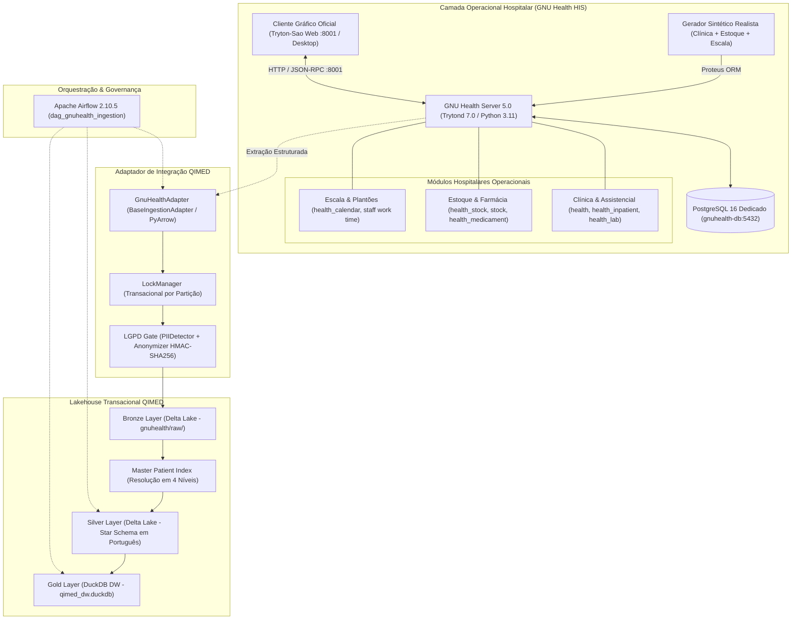

# Arquitetura de Implantação e Integração — GNU Health & QIMED (Atualizado com Estoque e Escalas)

**Versão do Documento:** 1.1  
**Data:** 13 de Outubro de 2026  
**Status:** Especificação Arquitetural Aprovada com Escopo Expandido (Clínica + Estoque + Escalas de RH)

---

## 1. Visão Geral da Arquitetura

A solução estende a plataforma QIMED integrando o **GNU Health HIS (Hospital Information System)** como sistema hospitalar operacional de origem (OLTP), abrangendo o ciclo assistencial completo (prontuário, atendimentos, internações, exames laboratoriais), a **gestão de farmácia/estoque de insumos e medicamentos** e a **gestão de escalas de plantão dos funcionários da saúde**. O **QIMED DataQore** atua como plataforma transacional e analítica de Lakehouse (Delta Lake e DuckDB).

---

## 2. Componentes e Tecnologias

### 2.1. GNU Health HIS (Camada Operacional)
* **GNU Health HIS 5.0** sobre **Tryton 7.0 LTS**.
* **Módulos Ativados:**
  * `health`: Modelo base de pacientes, profissionais, consultas e avaliações.
  * `health_inpatient`: Internações hospitalares, enfermarias e leitos.
  * `health_lab`: Exames laboratoriais e laudos.
  * `health_socioeconomics`: Determinantes sociais de saúde.
  * **`health_stock` & `stock`:** Gestão de medicamentos, insumos hospitalares, armazéns/farmácias e movimentações de estoque.
  * **`health_calendar`:** Escala de profissionais, turnos de plantão e alocação por unidade assistencial.
* **Banco de Dados Operacional:** PostgreSQL 16 isolado (`gnuhealth-db`), porta interna 5432, mapeada externamente para 5434. Volume Docker persistente `gnuhealth-postgres-data`.
* **Rede:** Conectado à rede `qimed-network`.

### 2.2. Cliente Gráfico Oficial
* **Tryton-Sao** integrado ao servidor na porta `8001`, permitindo operação gráfica pelo navegador web sem instalação de dependências locais no host.
* Porta `8001` também atende conexões JSON-RPC caso o operador opte pelo cliente desktop nativo `tryton.exe`.

### 2.3. Gerador Parametrizável de Dados Sintéticos
* **Geração em Duas Fases:**
  * **Fase A (Validação Rápida):** 200 pacientes, 800 atendimentos, 50 internações, 30 medicamentos/insumos em estoque e escala semanal de plantão dos 60 profissionais.
  * **Fase B (Volume Médio Completo):** 2.000 pacientes, 8.000 atendimentos, 500 internações, 5.000 exames, catálogo completo de farmácia/estoque com movimentações e escala mensal ininterrupta de plantões.
* **Relacionamentos Coerentes:**
  * Prescrições e internações geram requisições e baixas no estoque de medicamentos (`health_stock`).
  * Atendimentos e internações vinculados a profissionais escalados no respectivo turno de plantão (`health_calendar`).

### 2.4. Adaptador de Integração QIMED (`GnuHealthAdapter`)
* **Herança:** `BaseIngestionAdapter` (`src/ingestion/adapters/base_adapter.py`).
* **Entidades Extraídas:**
  1. Pacientes e Dados Demográficos.
  2. Atendimentos Ambulatoriais e Diagnósticos (CID-10).
  3. Internações Hospitalares e Leitos.
  4. Exames e Laudos Laboratoriais.
  5. **Estoque Hospitalar:** Posições de estoque, medicamentos e movimentações de insumos.
  6. **Escala de Funcionários:** Turnos de plantão, profissionais e setores alocados.
* **Segurança LGPD:** Anonimização determinística de nomes de pacientes e profissionais (`PIIDetector` e `Anonymizer`).

### 2.5. Lakehouse Transacional QIMED
1. **Bronze (`lakehouse/bronze/gnuhealth/`):**
   * Partições Delta Lake organizadas por entidade e competência:
     * `patients/`
     * `appointments/`
     * `inpatient/`
     * `lab_tests/`
     * `stock_inventory/`
     * `staff_roster/`
2. **Silver (`lakehouse/silver/`):**
   * `dim_paciente`: MPI em 4 níveis e dados demográficos.
   * `dim_estabelecimento`: Cadastro da instituição e unidades.
   * `fct_atendimentos_ambulatoriais`: Consultas e queixas.
   * `fct_internacao`: Internações, leitos e desfechos clínicos.
   * `dim_medicamento_estoque`: Catálogo e posição física de insumos/medicamentos.
   * `fct_escala_plantao`: Registro unificado de escalas e alocação de profissionais.
3. **Gold (`warehouse/qimed_dw.duckdb`):**
   * Indicadores de ocupação, tempo de permanência, consumo médio de medicamentos por internação e taxa de cobertura de profissionais por plantão.
